# 多人共享记账系统 软件设计与建模报告

| 项目 | 内容 |
| --- | --- |
| 项目名称 | 多人共享记账系统 |
| 课程 | 软件工程实验（2026 秋）· 实验二 软件设计与建模 |
| 组队方式 | 二人组 |
| 甲方 | 冯一水 251220047 |
| 需求分析工程师 | 孙浩原 251220053 |
| 需求版本 | 实验一 `lab1-final`（`8376c636be4a286ee8df56f6ccb5daee67151851`） |

---

## 一、项目概况

宿舍或出行小组的共同开支通常由一人垫付。以宿舍购买公共用品为例，账本需要保留付款人、参与分摊的成员以及后续的更正记录。普通成员登记收支，账本所有者审核，结算时根据已审核的账目生成转账建议。系统以网页形式提供，金额统一使用人民币，成员自行完成转账。

| 模块 | 主要功能 | 实验一需求 |
| --- | --- | --- |
| 账号与平台管理 | 邮箱注册和登录；平台管理员维护账号，投诉访问须取得所有者对指定记录的授权 | 001、024、026 |
| 账本与成员 | 创建账本、邀请与本人确认、调整角色、主动退出、转让所有权、解散与恢复 | 002–006、025 |
| 收支记录与类别 | 草稿、提交、撤回、审核与驳回、作废和关联更正；校验金额与分摊；管理类别 | 007–013、019–021 |
| 查询、统计与预算 | 按日期、类别、金额区间、记录人、付款人筛选并分页；月度支出、分类与成员统计；月度总预算、分类预算及提醒 | 014–016、027 |
| 结算与历史快照 | 平均与自定义分摊、转账建议、结算锁、历史快照、后续差额调整 | 017–018 |
| 操作日志 | 记录关键操作及前后值；所有者查账本全量，普通成员查本人相关日志 | 022、031 |
| 运行保障 | 每日备份与恢复；响应式页面、多端登录、断网表单保护 | 028–030、032 |

只读成员可查看账目和统计，也可主动退出。普通成员可提交和处理自己的未完成记录。账本所有者还负责审核、预算、结算及账本管理。服务端以当前成员关系、目标账本和操作类型统一校验；退出后的成员保留历史关联，其旧账本链接失效。平台管理员通过独立入口维护账号，投诉访问检查所有者的同意、工单和记录范围，每次访问和越权尝试均留痕。

## 二、软件架构与 UML

### 2.1 UML 组件图（结构性图）

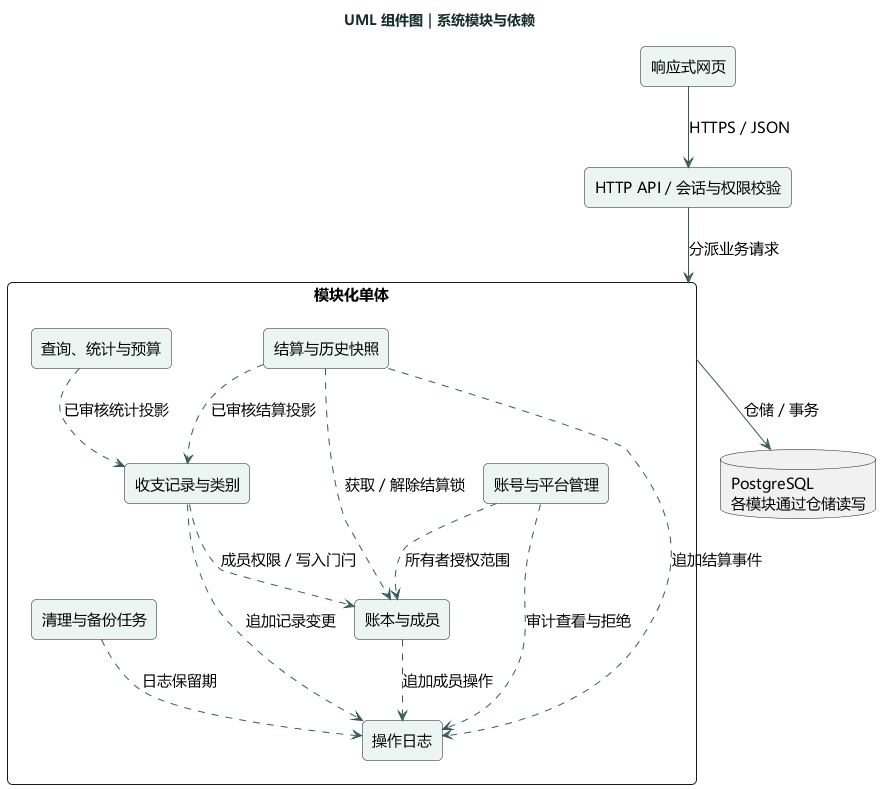

图 1　系统模块与依赖。

系统由网页前端、后端服务和 PostgreSQL 数据库组成。成员权限、记录状态和结算经常要一起判断。比如一笔账审核通过时，状态变化和审核日志要一起写入。把相关写操作放在同一个数据库事务里，失败时可以一起回滚。后端仍按业务划分模块，通过接口交换数据。

统计模块从记录模块读取已审核的账目。结算模块先在账本模块锁定本次结算的输入，再读取记录和分摊明细。审核、作废、成员变更和结算都交给日志模块留痕。平台管理员处理投诉时，账号模块先检查账本所有者授予的访问范围，再读取指定记录。

### 2.2 UML 类图（结构性图）

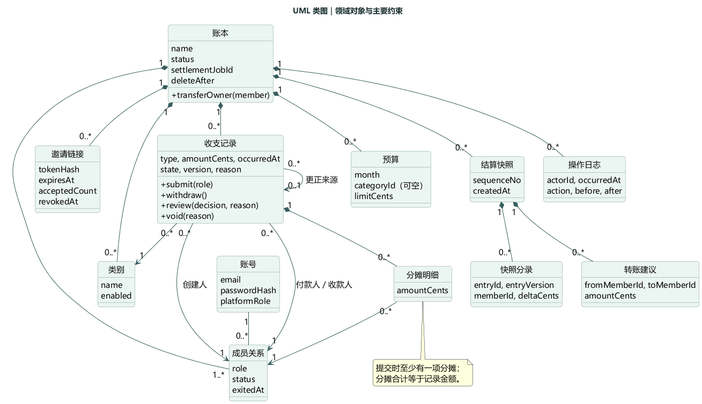

图 2　领域对象及其主要关系。

同一个人可以是宿舍账本的所有者，也可以是旅行账本的普通成员，因此角色和退出状态都保存在成员关系中。记录里引用的是这条成员关系。这样成员退出后，打开旧账仍能看见当时谁垫了钱、谁参与分摊。更正记录通过原记录编号保留来历；结算快照则保存每期的分录和转账建议，方便事后核对金额。

### 2.3 UML 状态图（行为性图）

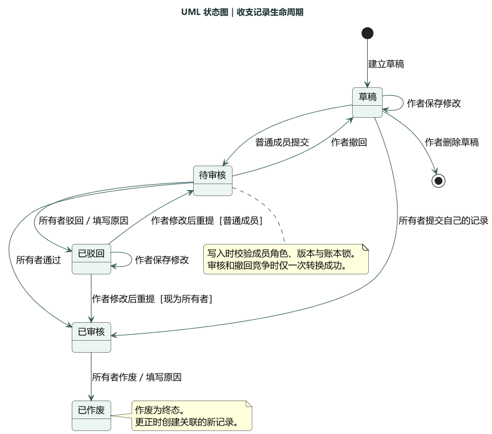

图 3　收支记录生命周期。

普通成员提交后进入待审核，所有者提交自己的记录直接进入已审核。创建人可在审核前撤回至草稿；所有者驳回时填写原因，创建人修改后可重新提交。作废必须填写原因，作废为终态。需要更正时先作废原记录，再新建关联记录，按当前角色走提交流程。记录保存携带版本号，审核与撤回竞争时以首个成功提交的事务为准，随后请求刷新状态并保留未提交内容。重复审核按当前已处理结果提示。

### 2.4 UML 时序图（交互性图）

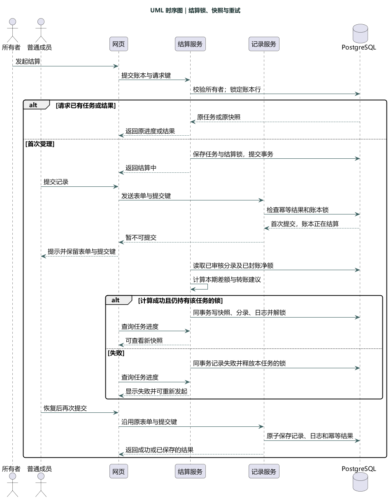

图 4　发起结算、拒绝并保留录入、生成快照、恢复提交。

结算请求先校验所有者并锁住账本行，在短事务内持久化任务和账本锁。相同请求键返回同一任务或快照，账本同时只允许一个活跃结算任务。记录、审核、作废等影响结算输入的写操作也先锁同一账本行，再检查结算锁并变更数据，因此输入在结算窗口内稳定。第一次遇到结算锁的提交返回可重试结果，表单和提交键仍在浏览器。结算服务凭当前任务身份在同一事务内写快照、分录、日志并释放锁；失败时记录失败并释放仍归本任务持有的锁。实现时应给任务设置可续期的执行期限，进程中断后由恢复任务清理过期占锁，旧执行者在最终写入前重验任务身份。

记账提交键按账本、操作者和操作作用域去重，并绑定表单内容摘要；相同内容的成功重试返回已保存的结果，同键不同内容提示冲突。结果与记录、日志一起提交；记录未写入时保留重试能力。新页面打开时按服务器当前状态刷新，版本冲突保留用户输入供比较。

### 2.5 数据存储和一致性设计

| 数据 | 持久化和约束 |
| --- | --- |
| 账号、会话 | 邮箱规范化后唯一；保存带盐密码哈希；多端会话独立过期。 |
| 账本、成员、邀请 | 账本包含状态、结算任务与删除期限。成员以账本和账号唯一。创建账本与建立所有者身份同事务；转让同步更新双方角色。确认邀请时重新检查有效期、撤销标记、活跃关系和成功人数，在同一事务中更新成员关系与计数。有效期 7 天，最多 10 人成功加入。 |
| 记录、分摊、类别 | 账本内外键校验，避免跨账本引用；记录保留版本、状态、原因、创建人与更正来源。金额以整数分存储；接受 0.01 元至 1 亿元且最多两位小数。已被引用的类别只能停用；同账本类别名唯一。 |
| 预算、查询 | 按账本、月份及可空类别定义月度总预算或分类预算。查询条件取交集，金额区间含端点，按发生时间和记录编号稳定排序。对账本、日期、状态及高频过滤列建立组合索引。 |
| 结算 | 保存结算任务、不可变快照、按记录版本和成员保存的差额分录及转账建议。同账本快照期次唯一，重复点击复用现有任务。 |
| 访问授权与审计 | 授权保存工单、账本、所有者、管理员与允许查看的记录范围。日志按账本和时间查询，只追加；普通日志保留 1 年，已结算账目的相关日志随账本及解散后的 30 天保留期保存。 |
| 恢复与清理 | 解散后将账本标为待删除，所有者可在 30 天内恢复；过期任务清理相应业务数据。每日自动备份，保留最近 30 天；在隔离环境演练恢复。恢复时间及数据损失目标待评估。 |

**分摊与快照。** 平均分摊用整数分整除，剩余的分按成员编号稳定分配。自定义分摊合计须等于记录金额。支出中，付款人的垫付额记为正，分摊人的承担额记为负；共有收入暂按相反方向入账，收款人收到款项，收益分配给对应参与人。每笔记录的净额合计为零。结算按成员汇总正负净额，逐项匹配欠款与应收，生成建议。

**补录与作废。** 本期按「当前已审核分录减去历次已封账分录的累计值」计算差额。旧日期的新记录首次计入，已封账记录作废后生成反向分录，更正记录审核通过后单独计入。例：原记录为甲垫付 200 元，甲乙均摊，第 1 期建议乙向甲转 100 元。第 2 期作废原记录，更正为 160 元，产生原记录 −100 元与新记录 +80 元的甲方净额，故本期建议甲向乙调账 20 元；第 1 期仍显示原结果。这里以结算建议已入账为跨期计算口径，实际转账状态由成员在系统外确认。

**统计口径与预算提醒。** 成员支出按付款人汇总，表示每个人实际垫了多少钱。预算统计采用已审核金额。原型把使用率达到 80% 作为提醒起点，超过预算后仍可以继续记账。80% 是界面原型的取值。

**验证方法。** 性能测试按 REQ-027 模拟 20 个用户并发操作，分别执行 100 次普通查询和 100 次统计查询。普通查询至少 95 次应在 2 秒内成功，统计至少 95 次应在 5 秒内成功。易用性按 REQ-029 检查，请 5 位新用户完成第一次记账，观察是否至少有 4 位能在 6 步、3 分钟内完成。

## 三、UI 界面与交互说明

桌面端左侧可以切换模块，页面顶部保留当前账本和角色。记账、审核和结算页面沿用同一套状态颜色。手机端把收支表格改成卡片，便于一眼看到金额和审核状态。下图用「四人宿舍账本」演示不同操作，图中的金额和记录都是示例。

### 01 注册与登录

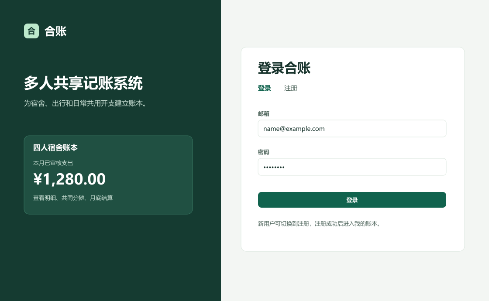

使用邮箱和密码登录，注册成功自动进入个人首页。邮箱已注册时在注册表单提示更换，登录失败采用统一提示。

### 02 我的账本

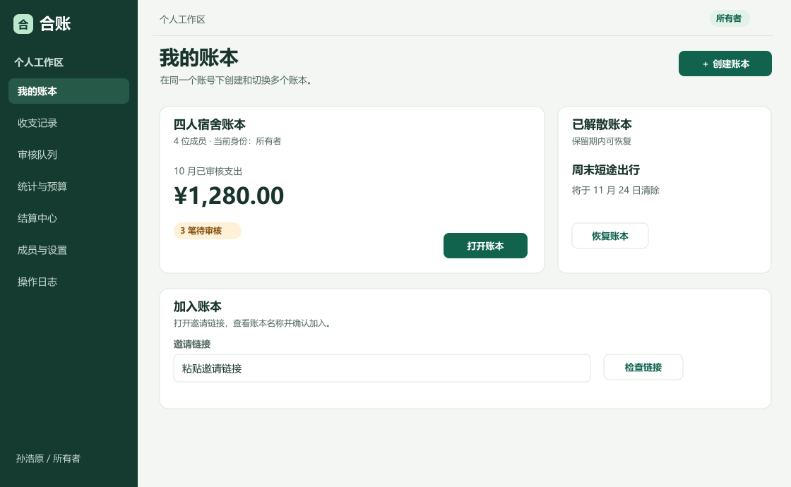

创建账本时去除名称两侧空格并校验非空。可打开现有账本、检查邀请链接或恢复保留期内已解散的账本。

### 03 成员邀请与设置

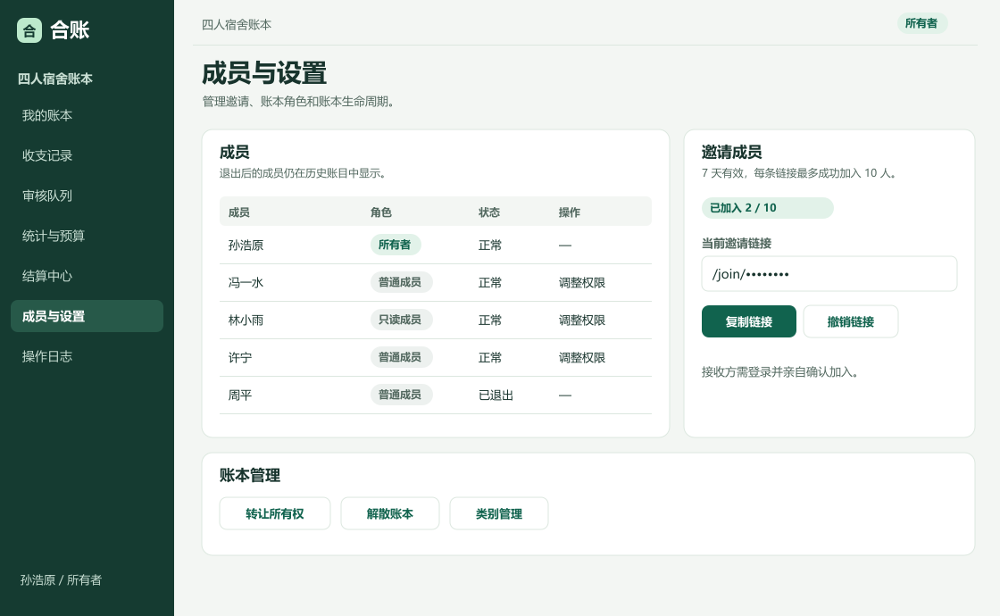

所有者复制或撤销邀请、调整普通／只读角色，确认后转让所有权或解散。普通及只读成员视图在管理区展示退出入口。

### 04 收支查询

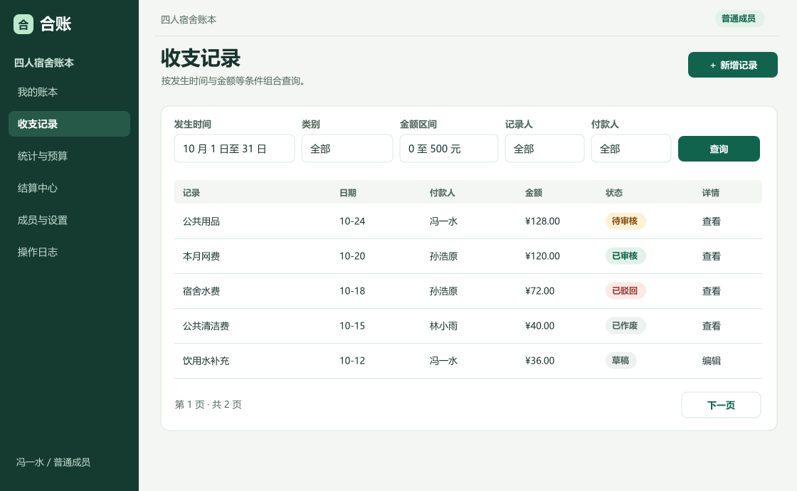

组合筛选并分页。无匹配时显示空结果并保留筛选条件。创建人可按状态查看、编辑、删除草稿、撤回待审核记录或修订被驳回记录。

### 05 新增记录与锁定反馈

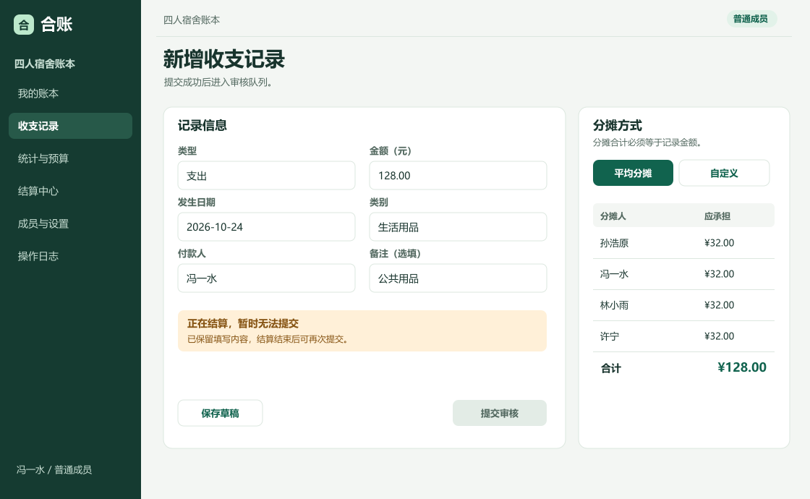

录入收支、类别、日期、付款人、分摊和备注。金额和分摊错误就地提示。结算锁定期间保留内容；断网暂存按账号与账本隔离，提交成功后清除。

### 06 审核队列

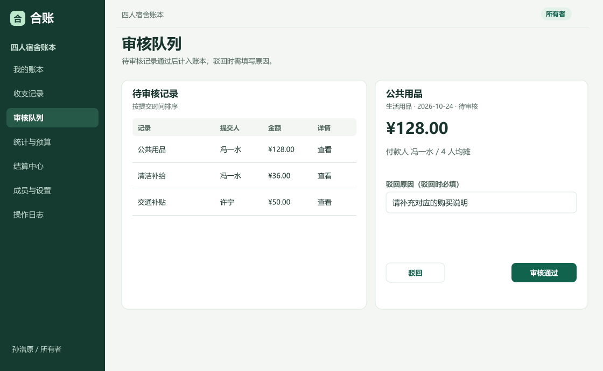

所有者查看待审核条目及分摊明细，选择通过或填写原因驳回。并发处理后刷新条目并显示服务器已记录的结果。

### 07 统计与预算

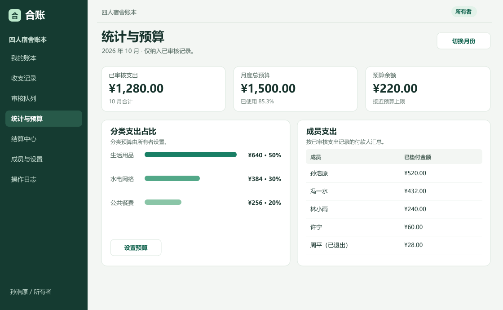

按月显示已审核支出、分类占比、成员垫付与预算用量。所有者可设总预算和各分类预算；空月份显示 0 元与空图表提示。

### 08 结算快照

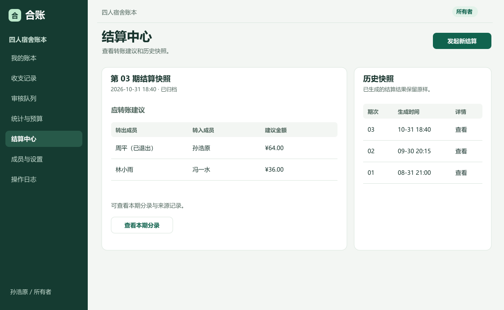

所有者发起新结算。运行中同一入口显示进度，结束后可查看冻结快照、分录和转账建议。所有角色按账本访问权限查看历史。

### 09 类别管理

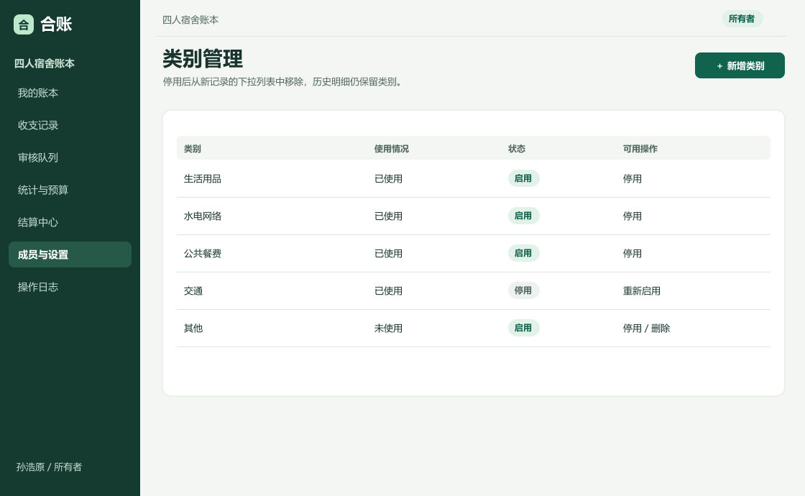

所有者维护账本内类别。已使用类别提供停用入口；新建表单只列启用类别，历史显示原类别。

### 10 操作日志

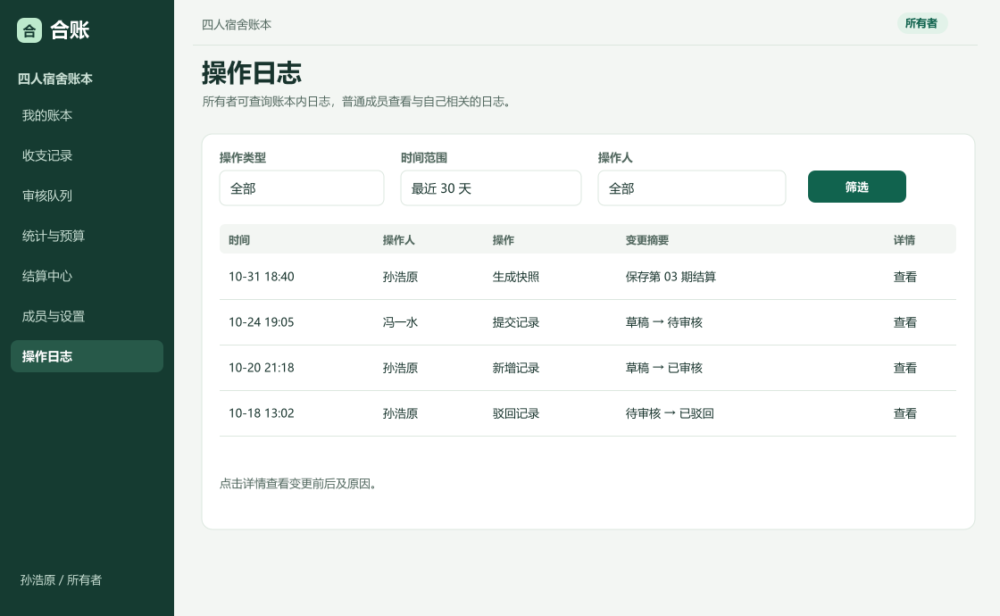

按时间、类型、操作人过滤，并可查看前后值及原因。普通成员查询由服务端限定到自己相关的操作。

### 11 平台管理

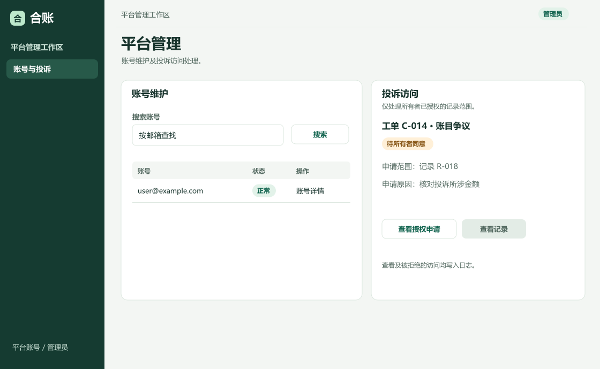

平台管理员在独立工作区维护账号并发起投诉授权。账本所有者查看工单和拟访问记录范围后选择同意或拒绝。授权生效后管理员可查看限定内容。

### 12 手机端收支

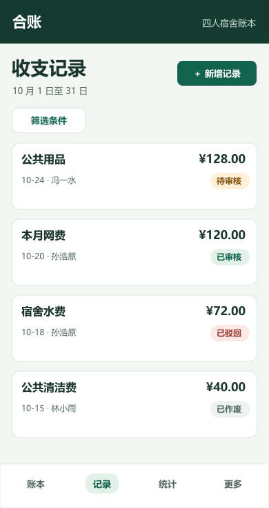

用单列卡片展示记录，筛选项放入面板，主操作保持在首屏。复杂表单采用上下分组，审核、设置等入口收纳至更多菜单。

### 13 作废与更正

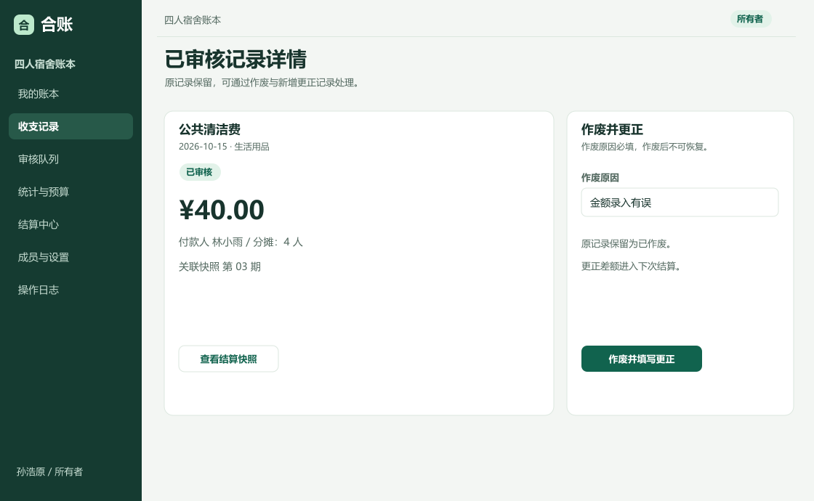

所有者填写作废原因，再打开新记录表单。创建更正记录后，新旧记录可互相追溯；原记录若曾结算，其差额在下一期处理。

### 14 邀请确认

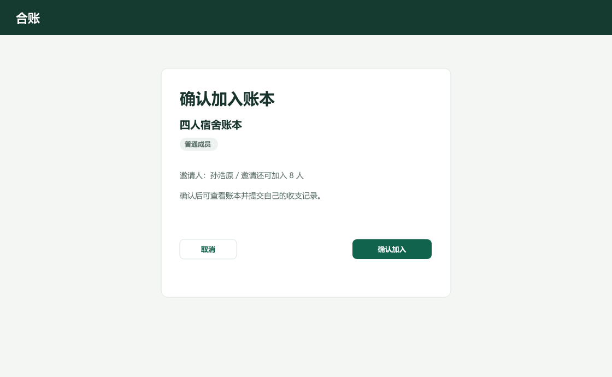

被邀请人登录后看到所属账本、邀请人及加入后角色，点击确认才成为普通成员。过期、撤销或名额已满时显示失效并请联系所有者。

## 四、实验总结

### 4.1 AI 辅助设计的过程与局限

| 使用场景 | 初稿结果与局限 | 修订结果 |
| --- | --- | --- |
| 需求梳理 | Codex 根据实验一资料生成模块清单和组件图初稿，便于检查各项功能是否有归属。实验一报告关于历史结算的表述和 REQ-018 存在冲突。 | 以定稿需求为准，历史快照保持原样，补录和作废产生的差额计入下一期。 |
| UML 建模 | Codex 生成四类 PlantUML 源文件，便于同时查看模块关系、对象关系和操作过程。初稿对结算中提交和审核与撤回并发的处理交代不足。 | 时序图补充结算锁定时保留表单与恢复后重试，状态图补充并发操作只能有一次状态转换成功。 |
| 界面设计 | Codex 生成统一样式的 SVG 界面稿，便于修改和批量导出。早期稿在普通成员的导航中显示了审核入口。 | 依据角色权限调整导航，补充结算锁定提示，并使用 Inkscape 导出界面图。 |

报告初稿由 Codex 根据图稿和需求映射整理。AI 初稿见 Git 提交 `c09aaff`，其中保留了最初的模块清单和组件图。

### 4.2 设计复核方法

可先根据定稿需求列出有代表性的业务场景，再生成图稿并逐一核对。例如，结算时提交应保留已填内容，普通成员不应看到审核入口，作废一笔已结算的账目后原快照仍可查。PlantUML 编译、图文引用和示例金额的计算可以用脚本检查。审核权限、结算方向和页面提示是否符合使用习惯，则需要结合具体场景判断。例如上一期的转账尚未发生时，用户能否根据两期结果理解当前应该转多少。

## 资料

- 实验一《多人共享记账系统需求整理》，`lab1-final`。
- [PlantUML 官方文档](https://plantuml.com/zh/)。
- [Inkscape 命令行导出说明](https://wiki.inkscape.org/wiki/Using_the_Command_Line)。
